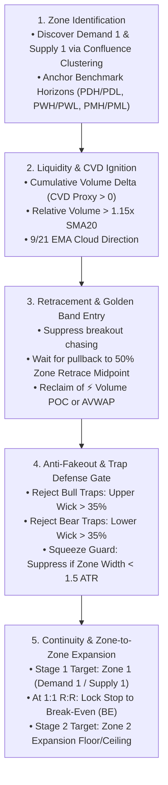

# 🏛️ UMX VYUHA — Institutional Stock Capture & Trading Engine

> **Algorithmic Multi-Timeframe Confluence Clustering | 40-Bin FRVP Volume POC | Zone-Anchored AVWAP | Anti-Trap Wicks | Real-Time Telegram Alerts & Web Dashboard**

---

## 📖 Overview

**UMX VYUHA (व्यूह)** is an institutional-grade quantitative scanning and execution engine. Built on order flow principles, VYUHA dynamically discovers where higher-timeframe participants (Monthly, Weekly, Daily swings, and benchmark horizons) converge, constructing clean **Institutional Action Zones (Demand 1 & Supply 1)** with zero floating gaps.

This repository combines:
1. **Python Multi-Timeframe Engine:** Daily EOD screening, 15-minute live intraday scanning, and automated risk management.
2. **Interactive Web Dashboard:** Real-time web UI powered by FastAPI (`http://localhost:8000`).
3. **Pine Script v6 Editions:** Companion TradingView indicators and strategies in [`pinescript/`](pinescript/).
4. **Termux / Mobile Ready:** Optimized to run 100% locally on Android devices without external hosting.

---

## ⚡ 5-Stage Institutional Hierarchy



---

## 🛠️ Project Structure

```
StockCapture/
├── breakout_scanner.py          # Master daemon scheduler (Daily + 15m Intraday)
├── backtest_vyuha.py            # Audited historical 2-year backtest engine
├── fast_optimizer.py            # Parallel precomputed optimizer
├── requirements.txt             # Python dependencies
├── README.md                    # System documentation
│
├── src/
│   ├── scanner/
│   │   ├── vyuha.py             # Core UMX VYUHA Institutional Engine
│   │   ├── core.py              # Market regime & NR7 inside-bar setups
│   │   ├── advanced_trend.py    # 15m EMA Cloud + ADX Momentum scanner
│   │   ├── eod.py               # EOD scan coordinator
│   │   ├── trades.py            # Trade tracking & risk management
│   │   └── smc_ai.py            # Monte Carlo SMC modules
│   │
│   ├── dashboard/
│   │   ├── server.py            # FastAPI dashboard server
│   │   └── index.html           # Interactive HTML5 dashboard UI
│   │
│   └── connectors/
│       ├── angelone.py          # AngelOne SmartAPI connector
│       └── zerodha.py           # Zerodha Kite connector
│
├── config/
│   ├── fo_tickers.json          # F&O Universe tickers list
│   ├── angelone_config.json.example
│   └── zerodha_config.json.example
│
├── data/
│   ├── watchlist.txt            # Current active watchlist
│   ├── vyuha_daily_watchlist.json # Daily curated institutional action candidates
│   └── vyuha_backtest_results.json# 50-Stock 2-year audited trade audit log
│
├── NSEDATA/                     # NSE constituent CSV datasets
└── pinescript/                  # TradingView Pine Script v6 strategy & guides
    ├── UMX_Vyuha_MTF_Confluence.pine
    └── UMX_Vyuha_Strategy_Guide.md
```

---

## 🚀 Quick Start

### 1. Installation
Clone the repository and install dependencies:
```bash
git clone https://github.com/Sivachandra1988/vyuha_stock_capture.git
cd vyuha_stock_capture
pip install -r requirements.txt
```

### 2. Configure Broker & Telegram (Optional)
Copy the example config:
```bash
cp config/angelone_config.json.example config/angelone_config.json
```
Edit `config/angelone_config.json` with your SmartAPI credentials.

*(For Telegram alerts, you can set the environment variables `TELEGRAM_BOT_TOKEN` and `TELEGRAM_CHAT_ID` or use the defaults in `breakout_scanner.py`).*

---

## 📊 Running Scanners

### A. Run Daily (EOD) Confluence Scan
Scans the liquid universe after market close or pre-market, computes MTF Demand 1 / Supply 1 zones, and generates tomorrow's watchlist:
```bash
python breakout_scanner.py --test-vyuha-daily
```

### B. Run Intraday 15m Live Scan
Checks active watchlist candidates against 15m candle closes for zone bounces, 50% retrace rejections, and AVWAP diamond triggers:
```bash
python breakout_scanner.py --test-vyuha-intraday
```

### C. Run the Continuous Daemon
Starts the automated background scanner loop (runs EOD scan at 15:15 IST and Intraday scans every 15 minutes during market hours):
```bash
python breakout_scanner.py
```

### D. Start the Web Dashboard
```bash
python src/dashboard/server.py
```
Open your browser at 👉 **`http://localhost:8000`**

### E. Run the 50-Stock Audited Backtest
```bash
python backtest_vyuha.py
```

---

## 📱 Running on Android (Termux)

This system can run 100% locally on an Android phone without needing cloud servers:

```bash
# 1. Inside Termux, install Ubuntu container
pkg install -y proot-distro
proot-distro install ubuntu
proot-distro login ubuntu

# 2. Install pre-compiled packages (zero compilation errors)
apt update -y && apt install -y python3 python3-pip python3-pandas python3-numpy git
pip3 install --break-system-packages -r requirements.txt

# 3. Run scanner
python3 breakout_scanner.py
```

---

## 🛡️ License
Private / Proprietary. For personal and algorithmic trading automation.

