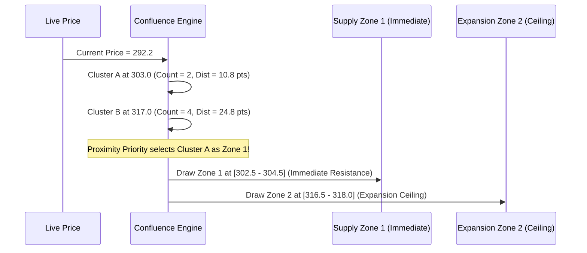
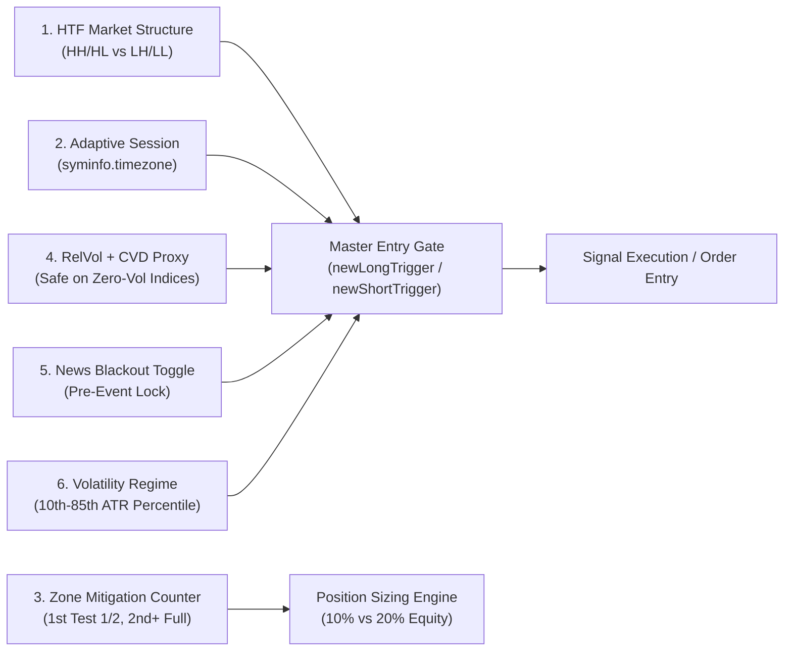
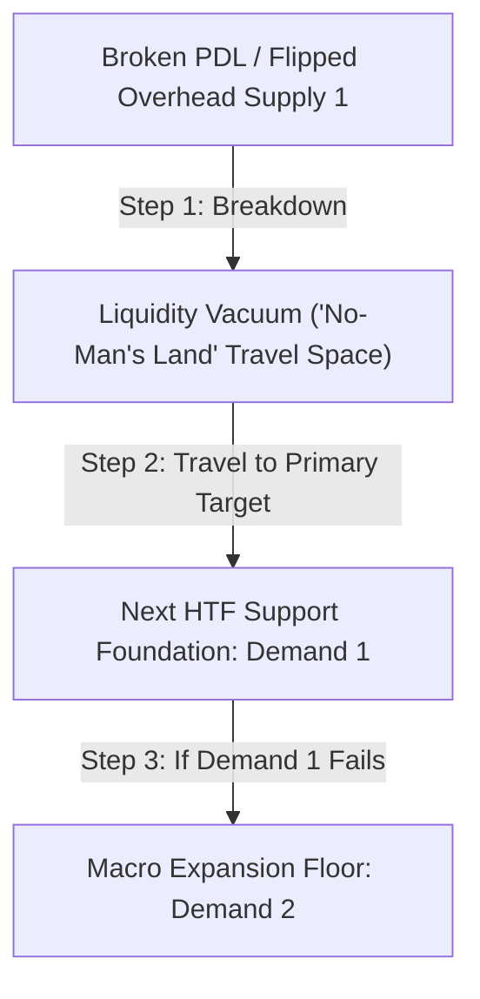
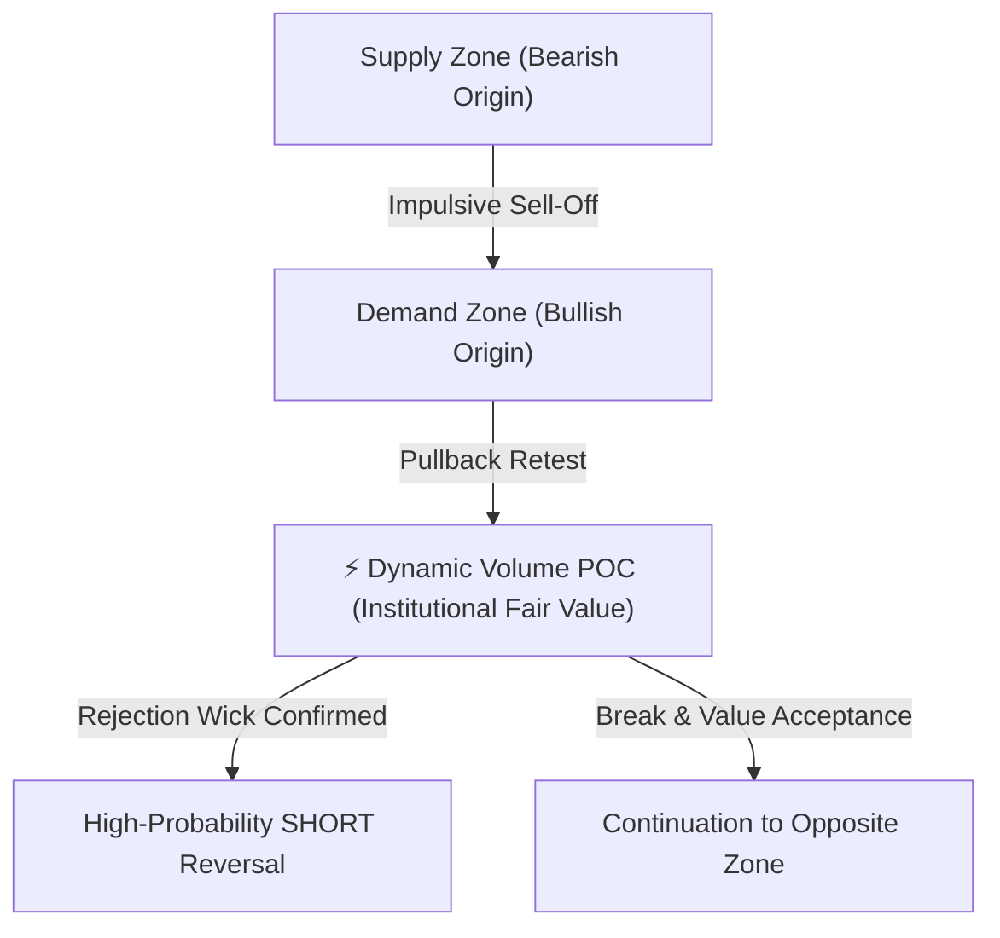
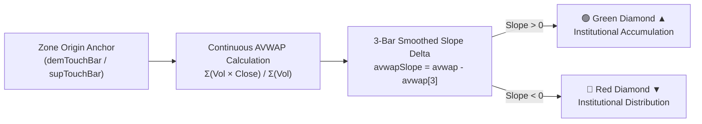

# 🏛️ UMX VYUHA — Institutional Multi-Timeframe Confluence & Clean Zone System Guide

> **Target Framework:** Pine Script v6 (Strategy & Study Editions)  
> **Core Script Files:**  
> * Strategy Edition (Full Confluence Strategy): [`UMX_Vyuha_MTF_Confluence.pine`](file:///c:/Workfolder/Pinescript/UMX_Vyuha_MTF_Confluence.pine)  
> * Pure Indicator Edition (Visual Overlay): [`UMX_Vyuha_MTF_Confluence_Study.pine`](file:///c:/Workfolder/Pinescript/UMX_Vyuha_MTF_Confluence_Study.pine)  
> * Classical Strategy: [`UMX_Vyuha_MTF_Strategy.pine`](file:///c:/Workfolder/Pinescript/UMX_Vyuha_MTF_Strategy.pine)  
> * Rapid Backtest Engine: [`UMX_Vyuha_Backtest_Strategy.pine`](file:///c:/Workfolder/Pinescript/UMX_Vyuha_Backtest_Strategy.pine)  
> **Execution Timeframes:** Intraday (5m, 15m), Swing (1H, 2H, 4H), Macro (Daily)  
> **Design Philosophy:** Clean Institutional Action Zones | Zero Chart Clutter | Proximity-Aware Targeting | Non-Repainting | Algorithmic Strategy Backtesting

---

## 1. System Architecture Overview

The **UMX VYUHA** architecture is built on institutional order flow principles: price moves from liquidity pool to liquidity pool. Instead of static, arbitrary indicator lines, VYUHA dynamically discovers where multiple higher-timeframe (HTF) participants converge, forming high-probability **Institutional Action Zones**.

```mermaid
flowchart TD
    subgraph Data_Layer ["1. Multi-Timeframe Data Ingestion"]
        D1["HTF Swings (M, W, D, 4H, 2H, 1H)"]
        D2["Benchmark Horizons (PDH, PDL, PDO, PDC, PWH, PWL)"]
        D3["Persistent Broken Structure Memory (Unmitigated Lows/Highs)"]
    end

    subgraph Clustering_Layer ["2. Proximity-Aware MTF Confluence Engine"]
        C1["Pool Valid Overhead Levels strictly > Close"]
        C2["Pool Valid Underlying Levels strictly < Close"]
        C3["Confluence Clustering within Max ATR Radius"]
        C4["Priority Filter: Select Nearest Valid Cluster to Price for Zone 1"]
        C5["Expansion Filter: Select Distinct Secondary Ceiling/Floor for Zone 2"]
    end

    subgraph Boundary_Layer ["3. Candle Structure Snapping & Envelopment"]
        B1["Envelop Active Cluster Bounds [Min, Max]"]
        B2["Scan Historical Testing/Origin Candles"]
        B3["Snap Zone Edges to Candle Wicks & Bodies (Zero Floating Gap)"]
        B4["Anchor Horizontal Projection to Touch Bar"]
    end

    subgraph State_Layer ["4. Role Reversal & Smart Clutter Control"]
        S1["Breakdown / Breakout Detection"]
        S2["S/R Flip (Broken Demand → Supply / Broken Supply → Demand)"]
        S3["Zone 2 Deduplication Guard (Suppress if < 1.5 ATR from Zone 1)"]
        S4["Reversal-Driven Completed Zone Visibility (Hide during expansion)"]
    end

    subgraph Execution_Layer ["5. Signal Generation & Risk Engine"]
        E1["Trend Start (9/21 EMA Cloud Flip)"]
        E2["Trap Wick & Anti-Fakeout Suppression"]
        E3["Retracement Entry Box (Golden Band inside Zone with SL)"]
        E4["1:2 R:R Trade Tracker & HUD Matrix"]
    end

    Data_Layer --> Clustering_Layer
    Clustering_Layer --> Boundary_Layer
    Boundary_Layer --> State_Layer
    State_Layer --> Execution_Layer
```

---

## 2. Core Functional Engines & Flow Design

### A. Multi-Timeframe Data Ingestion Layer
The system pre-fetches consolidated HTF security tuples to guarantee zero `NaN` values and stay within TradingView limits:
1. **Benchmark Horizons:** Previous Day (`PDH`, `PDL`, `PDO`, `PDC`), Previous Week (`PWH`, `PWL`), Previous Month (`PMH`, `PML`).
2. **HTF Horizontal Swings:** Monthly (1Y), Weekly (1Y), Daily (4M), 4-Hour (2M), 2-Hour (2M), and 1-Hour (2M) swing extremes.
3. **Instrument-Specific Modes:**
   * **Options Contracts Mode:** Automatically restricts lookbacks to the active contract's expiry horizon (max 22 Daily bars, 35–45 intraday bars) so premium decay and strike scales are never distorted by obsolete historical data.
   * **Futures / Stocks / Commodities Mode:** Deploys full multi-month structural lookbacks and multi-day swing hold targets.

---

### B. Proximity-Aware Confluence Engine (Zone 1 vs Zone 2)

Earlier iterations of confluence algorithms greedily picked whichever cluster had the largest total level count, regardless of distance. This caused **Zone 1** to jump to extreme macro peaks 25–40 points away, leaving the immediate overhead resistance unmonitored.

**The VYUHA Proximity Solution:**
* **Zone 1 (Immediate Action Zone):** Evaluates all clusters with valid confluence ($\ge 2$ converging HTF levels). The valid cluster **closest to current price** is selected as Zone 1.
* **Zone 2 (Expansion Target):** Projects the secondary structural target beyond Zone 1.
* **Zone 2 Deduplication Guard:** Zone 2 is strictly required to be at least **$1.5 \times \text{ATR}$** separated from Zone 1. If Zone 2 resolves to the same level or overlaps Zone 1, **Zone 2 is automatically suppressed**, preventing double boxes and colliding text.

---

### C. Persistent Broken Structure Memory (Role Reversal across Days)

In conventional indicators, when a new trading day begins at midnight, `benchLow` (`PDL`) shifts to yesterday's low. If price previously broke down through support two days ago, that critical broken level would vanish on day-rollover.

**The VYUHA Memory Engine:**
* When demand breaks down (`close < benchLow`), the broken support is stored in persistent memory (`unmitigatedBrokenLow`).
* It remains an **active overhead flipped supply level** across multiple sessions until price actually rallies back up and touches/sweeps it (`high >= unmitigatedBrokenLow`).
* Once tested by price, the level is officially marked **Mitigated** and cleared.
* Tagged on chart as **`🔴 SUPPLY ZONE 1 (FLIPPED DEMAND)`**.

---

### D. Dynamic Candle Structure Snapping (Zero Floating Gaps)

A frequent flaw in algorithmic supply/demand boxes is calculating borders purely from ATR padding, which creates boxes that hover in mid-air above or below candle wicks.

**The VYUHA Snapping Pipeline:**
1. **Cluster Envelopment:** The zone initialization sets `initSupBot = math.min(activeResMin, resAnchor)` and `initSupTop = math.max(activeResMax, resAnchor)`.
2. **Candle Wick Scan:** The engine scans the last 250 bars for historical candles that formed or tested into the cluster window.
3. **Exact Snapping:**
   * **Supply Zone:** Zone bottom snaps directly onto the candle's wick high and candle body (`math.min(initSupBot, cBody)`), perfectly sealing any empty gap.
   * **Demand Zone:** Zone top snaps directly onto the candle's wick low and body (`math.max(initDemTop, cBody)`).
4. **Origin Anchoring:** The left boundary of the box (`supTouchBar` / `demTouchBar`) anchors to the exact bar that initiated the test, extending forward into the margin.

---

### E. Smart UI De-Cluttering & Reversal-Driven Visibility

To maintain an institutional, clutter-free chart, VYUHA introduces intelligent dynamic visibility:

1. **Reversal-Driven Completed Zone Visibility:**
   * While price is in an active expansion (e.g., strong bull trend making higher highs after a breakout), the grey `⚪ COMPLETED DEMAND` box is **completely hidden**.
   * Only when price shows clear technical evidence of a pullback or reversal (`close < high[1]`, bearish candle close, or EMA crossunder) does the completed zone light up as an institutional retest target.
2. **Opposite-Edge Label Typography:**
   * **Zone 1 Labels:** Positioned on the **Right** (`text.align_right`).
   * **Zone 2 Labels:** Positioned on the **Left** (`text.align_left`).
   * **Retracement Bands:** Positioned on the **Left** (`text.align_left`).
   * Eliminates all overlapping text collisions between adjacent zones.
3. **Streamlined Typography:** Removed verbose suffixes like `(NEXT CEILING)` and `(PULLBACK AREA)`, adopting clean institutional notation:
   * `🔴 EXPANSION SUPPLY 2 [316.5 - 317.9]`
   * `🎯 RETRACE | SL: 305.18`

---

## 3. Visual Elements Reference Table

| Element | Style | Alignment | Behavior & Purpose |
| :--- | :--- | :--- | :--- |
| **Supply Zone 1** | 🟥 Solid Red Box | Right (`align_right, top`) | **Primary Action Zone:** Nearest overhead institutional resistance cluster strictly above price. |
| **Expansion Supply 2** | 🟥 Dashed Red Box | Left (`align_left, top`) | **Secondary Ceiling:** Next macro resistance target if Zone 1 breaks. Auto-suppressed if $< 1.5$ ATR from Zone 1. |
| **Demand Zone 1** | 🟩 Solid Green Box | Right (`align_right, bottom`) | **Primary Action Zone:** Nearest underlying institutional support cluster strictly below price. |
| **Expansion Demand 2** | 🟩 Dashed Green Box | Left (`align_left, bottom`) | **Secondary Floor:** Next macro support floor if Demand 1 breaks. Auto-suppressed if $< 1.5$ ATR from Demand 1. |
| **Retrace / Pullback Area** | 🟨 Dashed Gold Box | Left (`align_left`) | **Precision Entry Band:** Highlights the optimal pullback entry zone inside Zone 1 with exact Stop Loss level. |
| **Completed / Mitigated Zone** | ⬜ Dotted Grey Box | Right (`align_right`) | **Retest Liquidity Pool:** Origin level of major breakout/breakdown. Hidden during expansion; revealed on reversal. |
| **Active SL Line** | 🛑 Red Dashed Line + Tag | Right (`align_left`) | **Active Stop-Loss:** Labeled `🛑 ACTIVE SL: [price] ([risk] pts)` or `🛡️ SL (BREAK-EVEN)` when 1:1 R:R is achieved. |
| **Active TP Line** | 🎯 Green / Aqua Line + Tag | Right (`align_left`) | **Active Take-Profit:** Labeled `🎯 ACTIVE TP: [price] ([R:R] • [reward] pts)`. Green for Longs, Aqua for Shorts. |
| **Adaptive Benchmark Levels** | 🔴 / 🟢 Solid Line + Tag | Right (`align_left`) | **Timeframe-Adaptive Benchmark:** Automatically marks `🔴 PDH` / `🟢 PDL` on Intraday ($\le 60\text{m}$), `🔴 PWH` / `🟢 PWL` on Swings ($2\text{H}-4\text{H}$), and `🔴 PMH` / `🟢 PML` on Daily/Macro. |
| **EMA Cloud Ribbon** | 🟢 Green / 🔴 Red / ⚪ Grey | Overlay | Fast/Slow (9/21) EMA momentum direction and trend filter. |
| **Institutional HUD** | 📊 High-Contrast Dark Matrix | Top-Right | Live Status, Confluence %, Prev Day/Week H/L, HTF Swings, Live Trade Tracking & Edge Metrics. |

---

## 4. Definitive Institutional Execution Rules

### 🚀 1. Trend Start Entries
* **`🚀 TREND START BUY`:** Fired when the 9/21 Ribbon flips Bullish and price closes above the 9 EMA outside of resistance.
* **`📉 TREND START SELL`:** Fired when the 9/21 Ribbon flips Bearish and price closes below the 9 EMA outside of support.
* **State-Locked:** Stays in trade until resolved. Never spams repetitive signals in the same move.

### 🛡️ 2. Institutional Anti-Fakeout Filters
* **Rule 1 (Trap Wick Suppression):** If a candle displays an upper rejection wick $> 35\%$ of total candle range or $> 1.2\times$ body size, it is flagged as an institutional **Bull Trap** and all Buy signals are eliminated. Bottom wicks suppress Bear Trap short signals.
* **Rule 2 (Flipped Structure Protection):** Once a demand zone breaks down and flips to supply, **all Long entries are strictly blocked beneath the flipped zone**.
* **Rule 3 (Slow EMA Clearance):** Long signals require `close > 21 EMA` and a non-falling slow EMA line to prevent buying dead-cat bounces in macro bear trends.
* **Rule 4 (Pullback Entry Discipline):** Professional entries are taken inside the golden **Retracement Band** upon confirmation rejection, never by chasing the breakout candle.

---

## 5. Universal Market-Agnostic Execution Gates

To guarantee optimal performance across all global asset classes without hardcoded regional sessions or static symbol lists, VYUHA deploys **6 Modular Market-Agnostic Execution Gates**:

### 1️⃣ Higher-Timeframe (HTF) Market Structure Gate
* **Mechanism:** Pre-fetches confirmed HTF swing highs and swing lows (`request.security(syminfo.tickerid, htfStructureTF, ...)`).
* **Bias Logic:**
  * Bullish HH / HL Structure: `structureBias := 1`
  * Bearish LH / LL Structure: `structureBias := -1`
* **Execution Rule:** `htfBullAllowed = not useHtfStructure or structureBias >= 0 or (demBounceAllowed and not isEmaBear)`. When price arrives at a Demand zone during a macro bear trend, counter-trend buying is strictly blocked until confirmed by a Change of Character (closing above 9 EMA). Falling knives are completely eliminated.

### 2️⃣ Adaptive Session & Liquidity Window Filter
* **Zero Hardcoding:** Detects exchange session times automatically using `syminfo.timezone` and Pine Script's native `session.regular`.
* **Modes:**
  * **Auto (Exchange Hours):** Automatically syncs to local exchange hours (NSE: 09:15–15:30 IST, US: 09:30–16:00 EST, MCX: 09:00–23:30 IST, CME: 24/5).
  * **24/7 (Crypto):** Bypasses intraday session lockouts entirely for continuous crypto order flow.
  * **Custom Hours:** Allows discretionary window selection for custom trading sessions.
* **Core Liquidity Sub-Windows (Optional):** Restricts entries strictly to peak momentum opens (`0930-1130`) and market closes (`1330-1500`).

### 3️⃣ Second-Test Mitigation Sizing Engine
* **Institutional Principle:** The first tap into an unmitigated zone often absorbs initial pending liquidity. The second touch (re-test / mitigation) confirms institutional defense with significantly higher win rates.
* **Tracking Logic:** Monitors distinct visits to the active zone floor/ceiling (`demandTestCount` & `supplyTestCount`).
* **Dynamic Sizing Execution:**
  * **1st Test (`halfSizeLong` / `halfSizeShort`):** Conservative entry sized at **10% equity** (`[1/2 Size]`).
  * **2nd+ Test (`fullSizeLong` / `fullSizeShort`):** Confirmed entry sized at **20% equity** (`[Full Size]`).

### 4️⃣ Relative Volume & Cumulative Volume Delta (CVD) Proxy Gate
* **Relative Volume:** Requires `volume > 1.15 * SMA(volume, 20)` to confirm institutional presence.
* **Simple CVD Proxy:** Tracks cumulative aggressive volume flow `ta.cum(close > open ? volume : -volume)`. Confirms CVD is rising for longs and falling for shorts.
* **Zero-Volume Index Safety:** Automatically bypasses for spot cash indices (e.g., NIFTY, BANKNIFTY spot) where broker feeds report zero or tick volume, preventing execution deadlocks.

### 5️⃣ News Blackout Safety Gate
* **Mechanism:** Single-click input toggle (`newsBlackout = true`).
* **Action:** Immediately blocks new entries prior to high-impact scheduled events (RBI Monetary Policy, US CPI, Non-Farm Payrolls, FOMC rate decisions).

### 6️⃣ Volatility Regime Gate (ATR Percentile Distribution)
* **Percentile Distribution:** Ranks current ATR over a rolling 100-bar window (`ta.percentrank(currentAtr, 100)`).
* **Bounds:**
  * Drops entries if `< 10th percentile` (eliminates low-volatility, dead chop zones).
  * Drops entries if `> 85th percentile` (avoids chasing erratic panic wicks and extreme slippage).

---

## 6. Quick Settings Matrix per Market Type

| Asset Class / Market | HTF Structure TF | Session Mode | Volume Gate | Recommended Notes |
| :--- | :--- | :--- | :--- | :--- |
| **Indian Equities & Futures (NSE / BSE)** | `Daily (D)` | `Auto (Exchange Hours)` | Enabled | Auto detects IST timezone (`Asia/Kolkata`). Fully supports stock futures and index futures. |
| **Indian Cash Indices (NIFTY, BANKNIFTY Spot)** | `Daily (D)` | `Auto (Exchange Hours)` | Auto-Bypass | Spot indices have zero volume; CVD proxy automatically unlocks while HTF structure gates remain active. |
| **MCX Commodities (Crude Oil, Gold, Silver)** | `Daily (D)` or `4H` | `Auto (Exchange Hours)` | Enabled | Dynamically covers full morning and evening MCX trading sessions (09:00 to 23:30/23:55). |
| **Cryptocurrency (BTC, ETH, SOL)** | `4H` or `Daily (D)` | `24/7 (Crypto)` | Enabled | Continuous trading without session lockouts. 4H structure recommended on 15m charts. |
| **US Equities & Index Futures (ES, NQ, SPY, QQQ)** | `Daily (D)` | `Auto (Exchange Hours)` | Enabled | Auto syncs to `America/New_York` exchange hours with high-volume RTH opening drive support. |
| **Global Forex / CME Commodities** | `Daily (D)` or `4H` | `Auto` or `Custom` | Enabled | Adapts to CME / FX market hours and exchange timezones automatically. |

---

## 7. Two-Stage Action Zone Progression & Liquidity Vacuum Dynamics

### A. The "No-Man's Land" Liquidity Vacuum
When price breaks below a major benchmark balance level (such as `PDL`), the broken floor flips into active overhead resistance (**`Supply 1`**). The next institutional buyer support is not placed at arbitrary candle wicks, but anchored to the nearest confirmed **Higher Timeframe (1H/2H/4H) structural swing low** (**`Demand 1`**).

The space between the broken level and the newly formed Demand 1 is an institutional **liquidity vacuum** ("No-Man's Land"). Price is in active travel mode toward the next support foundation:
* **Pullback / Retest Phase:** Often, late intraday short-covering or bounce wicks will retest Supply 1 (`PDL`) before sellers commit to the next downward expansion.
* **Travel Phase:** While in between zones, chasing shorts directly is mathematically disadvantageous. Professional entries wait for either a high R:R rejection at Supply 1 or buyer exhaustion/absorption inside Demand 1.

### B. Two-Stage HUD Target Resolution
The HUD Action Matrix dynamically monitors two distinct stages of breakdown/breakout progression to avoid premature target jumping:

1. **Stage 1 (Benchmark Breakdown):**
   * Triggered when `close < benchLow` while `close >= demandZoneBot`.
   * **HUD Status:** `⚠️ DEMAND BROKE → Tgt: [Demand 1 Price]`
   * **Action:** Targets the newly surfaced **Demand 1** zone rather than skipping directly to macro expansion levels.
2. **Stage 2 (Expansion Breakdown):**
   * Triggered when `close < demandZoneBot` (Demand 1 floor fails).
   * **HUD Status:** `⚠️ DEMAND 1 BROKE → Tgt 2: [Demand 2 Price]`
   * **Action:** Targets secondary macro **Demand 2** (`sup2Anchor`).

*(Symmetrical logic applies to `Supply Breakouts`: Stage 1 targets `Supply 1`; Stage 2 expands to `Supply 2`).*

---

## 8. Release Notes & Patch Changelog (v6.2 Synchronization)

### 🛠️ Core Fixes & Enhancements

* **Refined Action Zone Target Progression:**
  * Fixed an issue where the HUD Action Zone jumped directly to `Zone 2` macro targets upon a benchmark break. The status now cleanly guides traders to `Target 1 (Demand 1 / Supply 1)` first, expanding to `Target 2` only after Zone 1 has been decisively broken.
* **Study / Confluence Backtest Engine Accuracy:**
  * In [UMX_Vyuha_MTF_Confluence.pine](file:///c:/Workfolder/Pinescript/UMX_Vyuha_MTF_Confluence.pine), fixed the profit calculation for Long trades hitting Break-Even trailing stops (`math.max(0.0, stopLossPrice - entryPrice)`). Locks accurate positive returns into the HUD Win Rate and Profit Factor metrics.
* **Strategy Tester Session Exit Synchronization:**
  * In [UMX_Vyuha_MTF_Strategy.pine](file:///c:/Workfolder/Pinescript/UMX_Vyuha_MTF_Strategy.pine), added explicit `strategy.close("Long", comment="Session Close")` and `strategy.close("Short", comment="Session Close")` handlers on `isNewDay` for Options contract mode. Ensures complete position cleanup in TradingView Strategy Tester reports.
* **Unified Codebase Alignment:**
  * Complete 1:1 parameter synchronization across both Study and Strategy editions.

---

## 9. Dynamic Fixed Range Volume Profile (FRVP) POC & Zone AVWAP

### A. The Institutional Auction Problem
While Supply & Demand zones define **where** institutional orders were placed, traders often struggle to pinpoint the **exact price equilibrium** within a wide zone or between zones where price will reverse. Profiling arbitrary bars manually often gives misleading volume clusters.

### B. The Automated Dynamic Solution
The VYUHA engine now computes the **Dynamic Volume Point of Control (FRVP POC)** and **Zone-Anchored VWAP (AVWAP)** in real time:

1. **Dynamic FRVP POC (Point of Control):**
   * Scans the auction candles between the active Supply origin and Demand origin.
   * Divides the range into 15 price buckets and aggregates transacted volume.
   * Plots a dashed **`⚡ VOL POC`** line at the highest-volume price node, labeled with the exact price and directional bias:
     * `⚡ VOL POC [Value] [BEAR POC RES]`: When price is testing Supply or retesting broken Demand. Acts as heavy institutional resistance.
     * `⚡ VOL POC [Value] [BULL POC SUP]`: When price is testing Demand or retesting broken Supply. Acts as heavy institutional absorption support.
   * Directly embedded inside the **Retrace Box**: `🎯 RETRACE (50% ENTRY) | ⚡ VOL POC: [Price] | SL: [Price]`.

2. **Zone-Anchored AVWAP:**
   * Anchors volume-weighted average price directly from the swing origin candle (`supTouchBar` / `demTouchBar`).
   * Gives traders the continuous institutional breakeven line for the current move.

### C. Reversal Execution Rules with Volume POC
* **Rule 1 (Bearish Retest Short):** When Demand breaks and flips to Supply, wait for the pullback into the **Retrace Box**. If price stalls at the **`⚡ VOL POC`** line with a rejection wick and the Red EMA Cloud is active, enter Short with Stop Loss placed above the zone ceiling.
* **Rule 2 (Bullish Bounce Long):** When price sweeps Demand, wait for price to touch or reclaim the **`⚡ VOL POC`** line. An engulfing or wick rejection candle with Green EMA Cloud confirms institutional absorption for a Long entry targeting Supply.
* **Rule 3 (Never Enter at POC in Dead Middle):** Never enter when price is oscillating sideways around POC in the neutral middle 50% zone without zone confluence; POC in a flat market acts as a chop magnet. Enter only at **Zone Rejections aligned with POC**.

---

## 10. Zone-Anchored AVWAP & Slope Diamond Dynamics

### A. Core Architecture
The Zone-Anchored AVWAP calculates the true cumulative volume-weighted average price from the structural zone origin anchor (`demTouchBar` / `supTouchBar`). To filter 1-bar high-frequency noise, the indicator calculates a multi-bar smoothed velocity delta:
$$\text{avwapSlope} = \text{avwapVal} - \text{avwapVal}[3]$$

### B. Dynamic Diamond Signals on Chart
Directly adjacent to the AVWAP forward price label sits a colored status diamond tracking real-time institutional pressure:
* **🟢 Green Diamond (`▲`):** Institutional accumulation is active. Price pulling back to touch AVWAP from above offers high-probability long retest confluence.
* **🔴 Red Diamond (`▼`):** Institutional distribution is dominant. Price rallying to touch AVWAP from below offers high-probability short retest confluence.

### C. Execution Playbook with AVWAP
1. **Long Entry Confluence:** Price testing Demand 1 + Green AVWAP Diamond + Price reclaiming AVWAP line + RSI $< 40$.
2. **Short Entry Confluence:** Price testing Supply 1 + Red AVWAP Diamond + Price rejected under AVWAP line + RSI $> 60$.
3. **Slope Flip Transition:** When price crosses AVWAP and the diamond transitions color, wait 1–2 bars for structural candle confirmation before committing capital.

---

## 10A. High-Resolution 40-Bin Fixed Range Volume Profile (FRVP) & 70% Value Area Engine

### A. Mathematical Foundation
To match TradingView's manual Fixed Range Volume Profile (FRVP) tool with exact mathematical parity, VYUHA computes a dynamic 40-bin volume distribution grid anchored to the active auction origin:

1. **Directional Impulse Anchoring:**
   * **Bearish Auction (`isBearBias = true`):** The profile anchors to the initiating **Supply Zone Origin** (`supTouchBar` / `supZoneStartBar`). It profiles the entire distribution leg from the supply peak down through the expansion moves.
   * **Bullish Auction (`isBearBias = false`):** The profile anchors to the initiating **Demand Zone Origin** (`demTouchBar` / `demZoneStartBar`), profiling the full accumulation rally up into supply.
   * **Bulletproof Early-Bar Clamping:** Lookback is strictly bounded between $1 \le \text{frvpLookback} \le \min(\text{bar\_index}, 180)$, guaranteeing zero `na` values and complete immunity against early-bar runtime errors (`RE10003`).

2. **Continuous Span Volume Distribution:**
   Rather than treating candle volume as a single discrete point (which creates artificial volume clustering), each candle's volume $V_i$ is distributed continuously across every price bin spanned from candle low to high:
   $$\Delta V_{\text{bin}} = \frac{V_i}{b_{\text{end}} - b_{\text{start}} + 1}$$

3. **70% Value Area Engine (VAH & VAL):**
   * **Point of Control (POC):** The price center of the bin containing the absolute highest cumulative volume ($\max(\text{volBins})$). Plotted with a dashed orange (bear) or cyan (bull) line and label `⚡ POC: Price`.
   * **70% Volume Boundary (Dual-Expansion):** Starting from the POC bin, the engine expands outward symmetrically, selecting the adjacent bin (above vs below) with greater volume until $70\%$ of total profile volume is encompassed.
   * **Value Area High (VAH):** The upper boundary of the $70\%$ volume band (red dotted line: `🔼 VAH: Price`).
   * **Value Area Low (VAL):** The lower boundary of the $70\%$ volume band (teal dotted line: `🔽 VAL: Price`).
   * **Viewport Synchronization:** Lines start at the auction origin candle (`pocLeftBar = frvpOriginBar`) and extend cleanly to `bar_index + 26`, matching the exact forward margin of the Equilibrium (EQ) and zone boxes for complete chart readability without clipping.

---

## 11. 50% Retracement Directional Engine & Zone Chop Protection

### A. Precision 50% Retracement Bands
Inside each active institutional zone, VYUHA renders a dedicated golden/amber 50% Retracement Band. Rather than confusing neutral text, it displays unambiguous directional action symbols:
* **`🟢 [BUY] DEMAND RETRACE (50%)`:** Signals optimal long entry at the discount midpoint of Demand 1 with a tight Stop Loss pinned at `demandZoneBot - (ATR * 0.5)`.
* **`🔻 [SHORT] SUPPLY RETRACE (50%)`:** Signals optimal short entry at the premium midpoint of Supply 1 with Stop Loss pinned at `supplyZoneTop + (ATR * 0.5)`.

### B. Channel Squeeze & Consolidation Guard (`isSqueezeChop`)
When volatility contracts and Demand Top and Supply Bottom compress within $< 1.5\times \text{ATR}$, or when price wicks repeatedly without directional follow-through:
* **Visual Status:** Box border shifts to a dotted amber warning style labeled:
  $$\text{⚠️ 50% CHOP / SQUEEZE ⏸️}$$
* **System Action:** All directional arrow triggers are paused (`⏸️`). Signals inside the tight consolidation range are suppressed until a decisive candle closes outside the boundaries.

---

## 12. Institutional Anti-Fakeout & Trap Detection Engine

### A. Wick Absorption & Cumulative Volume Delta (CVD) Proxy
Institutional "smart money" often induces retail breakout traders before reversing the auction. VYUHA deploys a 3-layer anti-trap gate:

1. **Bull Trap / Buyer Trap (Upper Wick Absorption):**
   * Condition: Candle pushes into resistance but closes with an upper wick $> 35\%$ of total candle range.
   * Volume Delta: Cumulative volume delta proxy ($\Sigma(\text{Close} - \text{Open})$) is declining while high prints higher.
   * State: Price remains below the 21 EMA.
   * Action: Long breakout signals are disqualified (`filterFakeouts = true`).

2. **Bear Trap / Seller Trap (Lower Wick Absorption):**
   * Condition: Candle pushes into support but closes with a lower wick $> 35\%$ of total candle range.
   * Volume Delta: Cumulative volume delta proxy is rising while low prints lower.
   * State: Price remains above the 21 EMA.
   * Action: Short breakdown signals are disqualified.

---

## 13. Pre-Market Trading Checklist

Before starting any live trading session with UMX VYUHA:

- [ ] **1. Identify Active Timeframe Tier:** On 5m/15m charts, verify `PDH / PDL` baseline is active. On 1H–4H charts, verify `PWH / PWL` baseline is active.
- [ ] **2. Check Zone 1 Anchors:** Confirm Demand 1 and Supply 1 locations relative to pre-market opening indications.
- [ ] **3. Note FRVP POC Position:** Note whether pre-market price is opening above or below the cyan/orange volume POC line.
- [ ] **4. Check AVWAP Diamond:** Note initial diamond color (🟢 Green ▲ or 🔴 Red ▼) on the anchor line.
- [ ] **5. Review HUD Matrix:** Check HTF Trend Bias, Confluence %, and Mitigation Test Grade (1st Test = 1/2 size, 2nd+ Test = Full size).
- [ ] **6. Check News Blackout Toggle:** If major macro events (RBI, CPI, FOMC, Fed Rate) are scheduled, toggle `newsBlackout = true` to lock out false breakouts.

---

## 14. Automated Strategy Execution & Backtesting Engine

### A. Direct Pine Script v6 Strategy Architecture
[`UMX_Vyuha_MTF_Confluence.pine`](file:///c:/Workfolder/Pinescript/UMX_Vyuha_MTF_Confluence.pine) is fully upgraded to a native Pine Script v6 Strategy. When loaded onto any chart, TradingView's built-in **Strategy Tester** activates immediately, providing institutional backtesting metrics:
* **Net Profit, Profit Factor (PF), and Percent Profitable (Win Rate)**
* **Max Drawdown (pts / %)**
* **Full Audit List of Trades with execution timestamps and tick-level fills**

### B. Execution Rules & Order Routing
1. **Long Position Entry (`strategy.entry`):**
   * Triggered on confirmed `buyCondition` (Demand Pullback, AVWAP Pullback, Retest Buy, or Trend Start Buy).
   * Position sizing dynamically adapts:
     $$\text{Contracts} = \left\lfloor \frac{\text{Equity} \times (\text{fullSizeQtyPct} / 100)}{\text{Close} \times \text{PointValue}} \right\rfloor$$
   * **Mitigation Test Sizing:** 1st zone test executes at $50\%$ sizing; 2nd+ confirmed retests execute at $100\%$ full size.
   * Hard Stop Loss placed at structural support floor (`stopLossBase`), and Take Profit target set to $1:N$ Risk-to-Reward (`takeProfit1`).

2. **Short Position Entry (`strategy.entry`):**
   * Triggered on confirmed `sellCondition` (Supply Pullback, AVWAP Pullback, Retest Sell, or Trend Start Sell).
   * Hard Stop Loss placed above the structural supply ceiling, and Take Profit target set to $1:N$ Risk-to-Reward.

3. **Active Trade Management & Trailing Break-Even (`strategy.exit`):**
   * Once price achieves $1:1$ Risk-to-Reward (halfway to TP1), the stop order automatically trails to **Break-Even** (`stopLossPrice := entryPrice`), locking the position into a completely risk-free state (`[BE 🛡️]`).

4. **Emergency & Session Closures (`strategy.close`):**
   * **Options Expiry Session Close:** On intraday options contracts, open positions automatically flatten before market close (`isNewDay and isOptionActive and closeAtDayEnd`).
   * **News Shock Exit:** A sudden volatility spike or structural invalidation immediately triggers an emergency market close (`strategy.close`).

### C. Live Performance HUD Table Integration
The on-chart HUD Table dynamically reflects both real-time order state and audited Strategy Tester statistics:
* **Live Trade Tracker:** Displays active direction (`🟢 LONG` / `🔴 SHORT`), entry price, running PnL points, and Break-Even status.
* **Audited Win Rate & Profit Factor:** Powered directly by `strategy.wintrades`, `strategy.closedtrades`, and `strategy.grossloss` for mathematically verified performance tracking.

